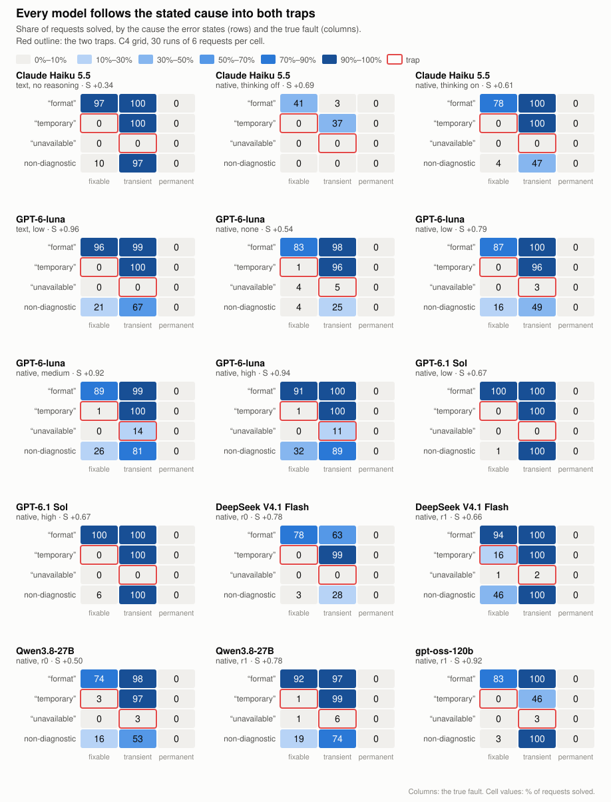
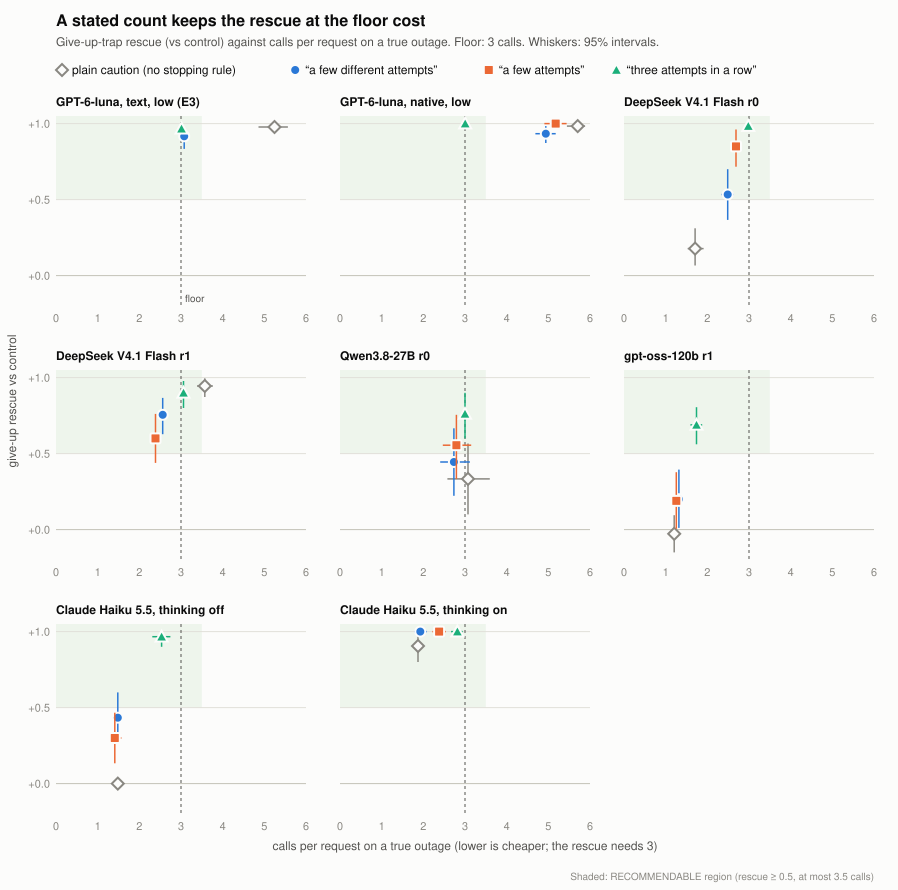

# Do LLM Agents Believe the Error Message? Stated Causes, Two Traps, and a Counted Stopping Rule

**Denis Gurskiy** · independent researcher · 7 November 2026

*Preprint, not peer reviewed. Code, protocols and every raw log: [github.com/XGenic/believe-the-error-message](https://github.com/XGenic/believe-the-error-message).*

## Abstract

When a tool call fails, the error message usually states a cause. An agent cannot see the true fault, so acting on that cause is reasonable; the question is how far it steers recovery, and what that costs when it is wrong. In a simulated stock-lookup tool we vary the stated cause independently of the true fault, across 18 pre-specified studies (about 20,400 conversations) on eight models from five developers. The clearest effect is giving up on recoverable requests: a false "unavailable" over a fault that would clear on a later call lowered success by 64 percentage points on average, against the non-diagnostic "request rejected" (at most 10% solved on 14 of 17 model-and-setting arms). The large exception, Gemini 3.8 Flash at its default, solved 61%. At lower reasoning it solved 17%, while more reasoning moved Claude Sonnet 5.5 only from 7% to 13%. The effect survived three rewordings on three of four models re-tested; the fourth, given a status-code version ("ERROR 404"), kept trying as if the request were at fault. A false "temporary" over a fixable fault left agents repeating a failed call, but most models seldom fixed that fault without it either, so this trap reflects weak exploration as much as the message. On the two models run for 18 requests, neither trap eased when every error looked alike, and on most models giving up was worst at a conversation's first failure. A caution plus a counted stopping rule ("If the same error comes back on three attempts in a row, accept it") rescued the give-up trap on all 8 model arms tested when faults cleared on the third call. When recovery times varied, agents applied the count to every error and abandoned real transient faults; for these read-only calls, a bounded retry in the tool's client rescued the trap without that loss.

## 1 Introduction

Tool-using agents read error messages the way people do: as diagnoses. "Temporary service problem" says wait and retry. "Not found" says stop. "Invalid format" says fix the request. Usually the diagnosis is right. Sometimes it is not: a load balancer answers "503 Service Temporarily Unavailable" when no servers are registered at all, and a storage service answers "no such bucket" for a bucket created moments earlier. An audit of 25 documented production cases (§3.5) finds both patterns, produced by systematic mechanisms such as security masking, eventual consistency and generic intermediary status codes; in 8 of them the message text itself states the wrong cause, the form our experiments use.

An agent cannot observe the true fault, so acting on a stated cause is reasonable: the message is evidence, and usually good evidence. What we measure is how far a stated cause steers recovery, and what that costs when the cause is wrong. We do not claim that stopping is irrational. An agent does not know that a third call would work, and a second identical error does not contradict "unavailable". Whether stopping is the right choice depends on how reliable such messages are, what a retry costs and what the agent knows, and this experiment does not establish those. What it does show is that the stated cause changes recovery decisions and, when it is wrong, can greatly reduce how many requests get solved. That matters for reliability, and it may matter for safety. Error strings are an input channel agents act on, so whoever controls one could make an agent abandon a task or keep repeating a failing call, without the instruction-like text that prompt-injection defenses look for. We show the behavior only for read-only lookups in a simulated tool; we do not demonstrate a real-world exploit.

We ask four questions:

1. **Do agents recover by the stated cause or by the true cause?**
2. **Do they revise a stated cause when their own calls give reason to doubt it?**
3. **What makes an agent persist or give up, beyond the message itself?**
4. **Is there a cheap instruction that helps across models?**

The design is a factorial grid: three true faults (fixable, transient, permanent) crossed with four stated causes (format, temporary, unavailable, and a non-diagnostic "request rejected"). Every study was pre-specified: its protocol, decision rule, predictions and spending cap were committed to version control before its first model call (§3.4 says what this does and does not establish), every decision rule was first validated on scripted agents with known behavior, and every deviation is logged.

**Contributions.**

- A paradigm that separates the stated cause of a tool error from its true cause, with a fixed coding of the agent's next action and pre-specified decision rules.
- Evidence across 17 model-and-setting arms that a false "unavailable" makes agents abandon recoverable requests, with one large exception (Gemini 3.8 Flash at its default, which solves far less at lower reasoning, while more reasoning shows no large, reliable gain on Claude Sonnet 5.5), and that this survives rewording on most models, while a false "temporary" adds less to an existing failure to explore, and that neither pattern changes with experience when every error looks alike.
- Evidence that on most models the give-up trap is worst at the first failure: one earlier error that cleared cuts stopping at once from 78–100% to 0–13% on GPT-6-luna, GPT-6.1 Sol and Qwen, and halves it on DeepSeek without reasoning, with a smaller effect on gpt-oss and none on Claude Haiku 5.5. Claude Sonnet 5.5 and Gemini 3.8 Flash do not stop at once at all, so that measure cannot show the effect on them, but a solved first request still decides most of their runs.
- A two-sentence instruction, a caution that error messages can be wrong plus a counted stopping rule, that rescues the give-up trap at about the minimum cost on every model tested in this environment; evidence that the rule's wording matters; and a test with varied recovery times, in which a bounded retry in the tool's client does as well on the trap without abandoning real transient faults.
- A fully reproducible record: raw logs of every call, hashes, and a command that re-scores every run byte for byte.

## 2 Related work

**Tool use and agents.** Tool-augmented language models (Schick et al., 2023) and reason-and-act agents (Yao et al., 2023) made tool calls a standard agent capability. Benchmarks such as τ-bench (Yao et al., 2024) evaluate agents in realistic tool environments, and LM-emulated sandboxes probe the risks of agent actions (Ruan et al., 2024).

**Unreliable tool feedback.** Closest to this work, Zhang et al. (2026) vary the content of tool observations (faithful, misleading or absent) and find that persistent misleading feedback can leave an agent worse off than no feedback at all. ToolMaze (Zhu et al., 2026) perturbs tools along explicit/implicit and transient/permanent failures, and finds that agents over-trust corrupted outputs and recover poorly. Both vary *what fails* or *what the tool returns*. To our knowledge, existing work does not isolate the variable studied here: we hold the failure fixed and vary only *the cause the error message states*, so the message's causal claim is the only thing that changes. Kraishan (2026) injects typed faults into a function-calling benchmark and finds that agents flag explicit errors far more often than plausible wrong values; our errors are all explicit, and what we vary is the cause they state. Yang et al. (2026) corrupt the returns of search, sub-agent and code tools on 14 models and find that agents often adopt wrong results; verification prompts reduce this, and reliability labels help only in part. Those are wrong results that look successful. Jeffries (2026) is closest to our logic: the tool's computation stays correct while its formatter changes, and stating omitted details, such as a search's coverage or a result cap, changes both agents' claims and verifiers' acceptance. Those are successful results with missing context, not failures with a stated cause.

**Repeating failed calls.** Gumaan (2026) finds that in small instruction-tuned models (135M to 1.7B parameters), adding a failed call and its error to the context makes the same call more likely to be repeated, mostly through the call's surface form rather than the error's meaning. That is a plausible competing account of our retry trap. Our design identifies the effect of the stated cause, not the mechanism behind the repetition (§4.1).

**Untrusted tool outputs as an attack surface.** Indirect prompt injection (Greshake et al., 2023) and AgentDojo (Debenedetti et al., 2024) show that instructions hidden in tool outputs can hijack agents. Our error messages contain no instructions at all, only causal statements, and a test enforces this. A misleading cause is a weaker, harder-to-filter form of the same channel.

**Attribution.** The design borrows from attribution theory: people explain outcomes by causes (Kelley, 1967), and the perceived stability of a cause shapes the expectation of future success (Weiner, 1985). The give-up trap also resembles learned helplessness (Seligman & Maier, 1967), with one difference: the agent never experiences the failures that would teach it, because it stops before them.

## 3 Paradigm

### 3.1 Environment

A fictional wholesaler has six depots. The agent answers stock requests ("how many units of glass fuse, SKU nt-2647, are on hand at the Dunmere depot?") with one tool, `stock_lookup(site, sku)`. A run is one conversation, of six requests in most studies (3 to 18 in others). The agent may make up to six calls per request, then must answer with a figure or "UNKNOWN". Three depots each expect a different SKU spelling, so a fixable fault is fixed by respelling the SKU.

| True fault | What happens | What works |
|---|---|---|
| fixable | rejected unless the SKU is spelled in the depot's convention | respell |
| transient | the first two calls of every request fail (R1 varies this) | any third call |
| permanent | every call fails | stop |

| Stated cause | Error text | Implied strategy |
|---|---|---|
| format | "the SKU is not written the way this depot's system expects" | respell |
| temporary | "temporary service problem" | retry |
| unavailable | "stock data for this depot is unavailable" | stop |
| non-diagnostic (*neutral* in the code) | "request rejected" | (comparison) |

We call "request rejected" non-diagnostic rather than neutral: it states no cause, but it is not neutral in its effect (§4.1, P1). The full grid has 12 cells: 3 accurate, 6 misleading and 3 non-diagnostic. The two cells this paper is about are the **retry trap** ("temporary" over a fixable fault) and the **give-up trap** ("unavailable" over a transient fault). In the give-up trap, for example, the agent looks up a depot's stock, receives "ERROR: stock data for this depot is unavailable.", and answers UNKNOWN; a third call would have returned the figure.

The environment is minimal by design: one tool, one argument convention and one true fault per cell, so the stated cause is the only thing that differs between the cells compared. Whether the effects carry over to multi-tool tasks, or to faults whose fix needs a semantic choice rather than a respelling, is the main open question (§5).

### 3.2 Measures

After each failed call, the agent's next action is coded by a fixed rule as RETRY (the identical call), REFORMAT (SKU changed), SITE_ONLY (depot changed), STOP (answered) or OTHER.

- **Steering S:** for each misleading cell, the share of first responses on request 1 that follow the stated cause, minus the same share under the non-diagnostic message with the same fault, averaged over the six misleading cells. S = 0 means the message has no effect on the first response; S = 1 means it moves every first response from the non-diagnostic baseline to the strategy the message implies.
- **Learning L\*:** the drop in following from requests 1–2 to requests 5–6 in the misleading cells whose outcomes contradict the claim, minus the same drop in accurate cells.
- **Trap success:** the share of requests solved in each trap. A request counts as solved when a lookup returned the figure. A correct final answer differs from this on 420 of 115,050 requests (0.4%). Of these, 355 are gpt-oss-120b's, whose replies were often garbled after a successful lookup, and 29 are Gemini 3.8 Flash's, 20 of them under the non-diagnostic message over a fixable fault, where it could fetch another depot's figure and then answer UNKNOWN. Scored on correct answers instead, no verdict in any of the 64 runs changes, and no trap rate in the panel (Table 1) moves by more than 0.011. Two non-diagnostic baselines move further, and Table 1 flags both: gpt-oss-120b's over a transient fault falls from 1.00 to 0.83, and Gemini's over a fixable fault from 0.36 to 0.25. The message effects measured against them shrink by the same amounts.
- **Message effect:** trap success minus success under the non-diagnostic message over the same true fault: how much of a trap the stated cause itself produces.

Intervals are 95% percentile bootstraps over runs (2,000 resamples). The run, one conversation, is the unit of analysis: the calls within a run are not independent observations, so intervals resample whole runs. Within a study every cell uses the same worlds (run r of each cell uses the same seed), but the bootstrap resamples each cell independently and ignores this pairing, which is conservative for a difference between two cells when their outcomes on the same world are positively correlated. Each study has a fixed decision rule and names one primary question. The C4 rule, for example, calls an agent CONTINUE_CREDULOUS when S is at least 0.25 (lower bound at least 0.10) and L\* is below 0.10 (upper bound below 0.20); CONTINUE_SELF_CORRECTING when S passes the same bar and L\* is at least 0.15 (lower bound above 0); and INCONCLUSIVE otherwise. Validity rules (at least 95% of runs complete in every cell, at most 10% protocol failures, the tool called on request 1 in at least 90% of runs) make a run INVALID before any verdict. The rules use fixed bars rather than significance tests, and no correction is made for multiple comparisons.

### 3.3 Models and access

| Model | Access | Settings |
|---|---|---|
| Claude Haiku 5.5 | Claude Code CLI (text format); Anthropic Messages API (native tool use) | no reasoning; thinking off and on |
| Claude Sonnet 5.5 | Anthropic Messages API (native tool use) | adaptive thinking, effort high (its default); effort max (G1) |
| GPT-6-luna | OpenAI Responses API (text format and native tool use) | reasoning none, low, medium, high |
| GPT-6.1 Sol | OpenAI Responses API (native tool use) | reasoning low, high |
| DeepSeek V4.1 Flash | OpenRouter, one pinned host (native tool use) | reasoning off and on |
| Qwen3.8-27B | OpenRouter, one pinned host (native tool use) | reasoning off and on |
| gpt-oss-120b | OpenRouter, one pinned host (native tool use) | reasoning on |
| Gemini 3.8 Flash | OpenRouter, Google AI Studio's flex tier (native tool use) | reasoning medium (its default; it cannot be turned off); low (G1) |

The first studies used a text reply format (`CALL stock_lookup {...}` or `ANSWER ...`); later studies use native function calling, translated into the same episode. A comparison on GPT-6-luna (§4.6) shows the traps do not depend on the format.

Reasoning settings name what was requested, not how much a model reasoned. Most arms in the panel reasoned very little in this task: only Gemini 3.8 Flash averaged more than 35 reasoning tokens per call (§4.6). Study G1 adds two settings outside the panel (§4.1).

### 3.4 Process

Studies are named by short codes (C4, E1–E5, N1, H1, W2-A to W2-E, W5, W6, R1, P1 and G1), listed in Appendix B. Every study followed the same sequence. The protocol, configurations and code were committed with a spending cap of zero. The decision rule was run against scripted agents with known behavior (50 in all) and checked for power over 20 disjoint seed sets. A one-run-per-cell pilot on a development seed had to pass a health gate (complete runs, at most 10% protocol failures, the tool used on the first request). Only then did the main run go ahead, within a cap approved in advance. Main runs use 30 runs per cell (60 per condition in E5). In all, the studies ran about 20,400 conversations and 444,000 model calls. Predictions were recorded before any call, and are scored in Appendix A, misses included. These pre-specifications were committed to the author's private working repository before each study's first call. The public repository is an export made on 28 October 2026, so its history cannot independently confirm their timing; they are pre-specified, not independently timestamped pre-registrations. The five latest studies were registered publicly before their first call, each as a tagged GitHub release and on OSF: W2-D (GPT-6.1 Sol; osf.io/z2pwa), R1 (recovery times; osf.io/d64ju), P1 (rewordings; osf.io/fmxaz), W2-E (Claude Sonnet 5.5 and Gemini 3.8 Flash; osf.io/2kf35) and G1 (reasoning or the model; osf.io/5qjzc). Before W2-E's registration, seven small cost probes ran on those two models to set its budget: accurate cells only, on seeds it does not use, reading token use and cost and not outcomes. Its protocol discloses them. Later studies will be registered the same way.

### 3.5 Misleading errors in the wild

To check that the patterns occur outside our environment, we collected 25 documented production cases in which an error message stated or implied the wrong cause, with sources. Seven follow the give-up pattern: a permanent-sounding message ("not found", "forbidden", "damaged") over something transient or fixable, such as identity-management propagation delays. Nine follow the retry pattern: a transient-sounding message (503, timeout, 429) over something permanent or client-fixable. Nine more point to the wrong fix. The causes are systematic: security masking, eventual consistency, intermediaries that do not know the real status, and status codes shared between unrelated states.

The cases carry the wrong cause in different ways. In 8 the message text itself states a wrong cause ("no space left on device" when the inodes, not the disk, are exhausted). In 6 the text is literally true but implies the wrong cause ("connection timed out" over a firewall rule that drops every packet). In the other 11 the wrong cause is carried by a status code and its standard phrase, sometimes beside accurate text (a 429 "too many requests" for an unpaid bill, with text that says so). Our manipulation, a cause stated in words, matches the first group most closely. Status codes may act differently: in P1 (§4.1), DeepSeek with reasoning kept trying under "ERROR 404" as if the request were at fault, the code's usual meaning, while the two worded variants only weakened its give-up effect. One wording on one model cannot show how far status codes carry conventions of their own. The collection is targeted, not a sample: it shows that these patterns exist, not how often they occur.

## 4 Results

### 4.1 The stated cause steers recovery, above all toward giving up

On the first two models, in the text format, steering was strong: S = +0.34 [+0.32, +0.37] for Claude Haiku 5.5 and +0.96 [+0.92, +0.98] for GPT-6-luna. Both were CONTINUE_CREDULOUS. Neither model solved a single trap request (0 of 180 in each trap, for each model). Under the non-diagnostic message the same transient fault was solved on 97% (Haiku) and 67% (Luna) of requests, so the "unavailable" message alone turned a recoverable fault into a lost one. The fixable fault was rarely solved under that message either (10% and 21%), and under "temporary" neither model ever respelled the SKU. Following the message on the first call is reasonable in itself. The cost shows up afterward. In the retry trap the agent made up to six identical calls, each returning the same error, without changing anything; in the give-up trap it stopped after one or two calls, before the third, which would have worked.

The pattern holds across the panel (Figure 1, Table 1). The retry trap is solved in at most 10% of requests on 16 of 17 arms; the exception is DeepSeek with reasoning on, at 16%. The give-up trap is solved in at most 10% on 14 of 17 arms; the exceptions are GPT-6-luna at medium and high reasoning effort, at 14% and 11%, and Gemini 3.8 Flash, at 61%, taken up below. The credulous verdict holds on 13 of 17 arms. The other four are INCONCLUSIVE because of a moderate L\*, and in none of them does the drift move toward the true cause: it comes from an accurate cell (GPT-6-luna with reasoning off), from rewriting the depot instead of the SKU (Qwen with reasoning), from withdrawing from the tool (gpt-oss), or from giving up on every error (Haiku). GPT-6.1 Sol, OpenAI's larger model, did what the message said in every run: it solved no trap request at either reasoning effort, and under "temporary" and "unavailable" all 30 runs of each cell behaved identically.

The two traps are not equally the message's doing. Against the non-diagnostic message over the same fault (Table 1), a false "unavailable" lowered success by 64 points on average across the 17 arms, and by 20 to 100 points on all but one. The exception, Haiku without thinking, gave up after any error, so the message could not make it worse. A false "temporary" lowered success by 14 points on average (0 to 35): on most arms the fixable fault was seldom solved under that message either, because agents retried or stopped rather than respelling the SKU. These are descriptive averages over arms that share models, not independent replications. The give-up trap is therefore a clean effect of the stated cause. The retry trap combines a smaller message effect with a general failure to explore. One account of the repetition itself, that a failed call in context makes its own repetition more likely (Gumaan, 2026), fits this pattern, and our design does not rule it out.

*Figure 1. Share of requests solved, by stated cause (rows) and true fault (columns), for every model and setting. Red outlines mark the two traps.*

*Table 1. The panel: C4 verdict (CREDULOUS = CONTINUE_CREDULOUS), steering S, and the share of trap requests solved (180 requests per trap: 30 runs × 6), with success under the non-diagnostic message over the same fault in brackets. Intervals for every cell are in `runs/panel/PANEL.md`. Scored on correct final answers (§3.2), two bracketed baselines fall, to \*0.83 and †0.25; no trap rate moves by more than 0.011.*

| Model, setting | C4 verdict | S | Retry trap (non-diagnostic) | Give-up trap (non-diagnostic) |
|---|---|---|---|---|
| Haiku 5.5, CLI text | CREDULOUS | +0.34 | 0.00 (0.10) | 0.00 (0.97) |
| Haiku 5.5, API, thinking off | INCONCLUSIVE | +0.69 | 0.00 (0.00) | 0.00 (0.00) |
| Haiku 5.5, API, thinking on | CREDULOUS | +0.61 | 0.00 (0.04) | 0.00 (0.47) |
| Sonnet 5.5, API, default | CREDULOUS | +0.67 | 0.06 (0.19) | 0.07 (1.00) |
| GPT-6-luna, text, low | CREDULOUS | +0.96 | 0.00 (0.21) | 0.00 (0.67) |
| GPT-6-luna, native, none | INCONCLUSIVE | +0.54 | 0.01 (0.04) | 0.05 (0.25) |
| GPT-6-luna, native, low | CREDULOUS | +0.79 | 0.00 (0.16) | 0.03 (0.49) |
| GPT-6-luna, native, medium | CREDULOUS | +0.92 | 0.01 (0.26) | 0.14 (0.81) |
| GPT-6-luna, native, high | CREDULOUS | +0.94 | 0.01 (0.32) | 0.11 (0.89) |
| GPT-6.1 Sol, native, low | CREDULOUS | +0.67 | 0.00 (0.01) | 0.00 (1.00) |
| GPT-6.1 Sol, native, high | CREDULOUS | +0.67 | 0.00 (0.06) | 0.00 (1.00) |
| DeepSeek V4.1 Flash, off | CREDULOUS | +0.78 | 0.00 (0.03) | 0.00 (0.28) |
| DeepSeek V4.1 Flash, on | CREDULOUS | +0.66 | 0.16 (0.46) | 0.02 (1.00) |
| Qwen3.8-27B, off | CREDULOUS | +0.50 | 0.03 (0.16) | 0.03 (0.53) |
| Qwen3.8-27B, on | INCONCLUSIVE | +0.78 | 0.01 (0.19) | 0.06 (0.74) |
| gpt-oss-120b, on | INCONCLUSIVE | +0.92 | 0.00 (0.03) | 0.03 (1.00\*) |
| Gemini 3.8 Flash, medium | CREDULOUS | +0.63 | 0.01 (0.36†) | 0.61 (0.99) |

S is not comparable across access methods: it is measured against each arm's own non-diagnostic baseline, and that baseline moves with format and reasoning (§4.6). The trap rates are the robust comparison.

**A larger Anthropic model and a Google model (W2-E).** A follow-up ran the grid and E5 on Claude Sonnet 5.5 and Gemini 3.8 Flash, one setting per model, each model's own default. Both were CONTINUE_CREDULOUS (S = +0.67 and +0.63). Sonnet solved 7% of the give-up trap, against 100% under the non-diagnostic message, and was SAME as Haiku with thinking on for S and both traps. Gemini solved 61% (Wilson interval over runs, 43–76%), against 99%. The message still cost it 38 points, but it is the only arm on which most give-up-trap requests were solved, and we had predicted at most 15%. The difference lies in one call. On request 1 of the trap, both models rewrote the depot on their second call in 29 of 30 runs. Sonnet then answered UNKNOWN in 28 of 30 runs. Gemini made a third call in 18 of 30, each time in a new form of the depot or SKU, and that call worked. After a first solved request, later requests were solved 96% of the time on Gemini and 100% on Sonnet, so most runs solved all six requests or none (17 and 11 of 30 on Gemini). This breakdown is exploratory. On the retry trap Gemini looks like the rest: 1% solved, against 36% under the non-diagnostic message, the largest message effect on that trap (35 points; 24 when scored on correct answers, where it is no longer the largest, §3.2).

**Reasoning or the model? (G1)** W2-E could not separate the two, and they were confounded: on the trap's first request Gemini reasoned a mean of 686 tokens, against at most 88 on every other arm. A follow-up registered publicly before its first call changed reasoning in both directions, on the same seeds (Table 2). At low reasoning, Gemini made the third call far less often and solved 17% of the trap. It still solved 100% under "request rejected", so the lower setting made it stop more often under "unavailable", not under every error: the message's effect grew from 38 points to 83. Claude Sonnet 5.5 at maximum effort reasoned twenty times as much as at its default and nearly twice as much as Gemini, and its success moved little. The pre-specified verdict is GEMINI_SPECIFIC, against our prediction of GEMINI_ITSELF. That label is a classification by fixed thresholds, not a finding about a mechanism inside Gemini. The reasoning setting made a large difference on Gemini; Sonnet showed no large, reliable gain in this experiment, though its interval allows a rise of up to 23 points. Within any one setting, how long a run reasoned did not separate the runs that solved the trap from those that did not (Gemini 306 and 286 tokens at low, 664 and 725 at its default; Sonnet 1,342 and 1,199 at maximum effort), so a setting may change more than its token count. G1 did not repeat Gemini at its default, compares with one other model, and covers this trap only.

*Table 2. G1: the give-up trap at each model's default (W2-E) and at the new setting, on the same seeds. Reasoning is the mean number of tokens on the trap's first request. Intervals are 95% percentile bootstraps over runs.*

| Model, new setting | Reasoning: default → new | Third call on request 1: default → new | Solved: default → new | New − default [interval] | Result |
|---|---|---|---|---|---|
| Claude Sonnet 5.5, maximum effort | 61 → 1,218 | 2 → 4 of 30 | 0.07 → 0.13 | +0.07 [−0.07, +0.23] | STAYS |
| Gemini 3.8 Flash, low reasoning | 686 → 290 | 18 → 6 of 30 | 0.61 → 0.17 | −0.43 [−0.63, −0.21] | FALLS |

**Does the wording matter? (P1)** A follow-up registered publicly before its first call re-ran the give-up trap with three rewordings of "unavailable" ("this depot has no stock data on record", "stock information is not available for this depot", "ERROR 404: no stock data found for this depot") and a second non-diagnostic sentence ("the request could not be completed"), on four models that had shown the effect. On GPT-6.1 Sol, GPT-6-luna and Claude Haiku 5.5 with thinking, every rewording was SAME as the original: success 0.00–0.06, against 0.39–1.00 under "request rejected". SAME refers to success, not to behavior: under the 404 wording Sol, which solved no request under any "unavailable" wording, made 1.7 calls per request against 1.0 under the original. On DeepSeek with reasoning the effect weakened with rewording (success 0.21 and 0.51) and vanished for the status-code form (0.99): under the 404 wording it rewrote the depot or the SKU and kept calling, behaving as though the error indicated a correctable problem with the request (the usual meaning of a 404). By the pre-specified rule the study-level answer is therefore mixed. The second non-diagnostic sentence was not equivalent to the first: under it Luna and Haiku persisted far more (0.86 against 0.61, 0.90 against 0.39), so effects measured against "request rejected" are, for these models, conservative.

### 4.2 Repeated identical errors do not change recovery behavior

In 18-request conversations where every error in a run is the same (E1), Haiku and GPT-6-luna solved 0 of 216 retry-trap requests and 0 of 216 give-up-trap requests. Both were NO_LEARNING. The give-up trap seals itself: obeying "unavailable" means the agent never makes the third call, so no contrary evidence ever arrives. In the retry trap the agent does see every failure, but a long outage would look the same: only a changed call would tell the two apart, and the agent never made one. Haiku remarked on the repetition within a request ("I've tried this lookup five times…") and still kept treating the fault as temporary.

### 4.3 The first encounter is the worst case, on most models

Pure-run traps are a worst case. In 12-request conversations that mix accurate and misleading errors (E4), plain GPT-6-luna solved about half of the give-up traps (45–55%, against 0 in pure runs). An exploratory split suggested why: before any error in the conversation had cleared on a later call, it stopped at once on 89–100% of "unavailable" messages; after one had cleared, on 21–40%.

A pre-specified follow-up (E5) tested this directly with three-request runs, varying only the first request. With no earlier error, GPT-6-luna stopped at once on 60 of 60 first "unavailable" messages. After one error that cleared on its third call, it stopped at once on 2 of 60. The difference, D1 = +0.97 [+0.92, +1.00], was CONFIRMED by the pre-specified rule. The effect replicated through native tool calls (+0.93) and at every reasoning effort, and it was CONFIRMED on 11 of 15 arms with a valid test. Its size varies by model. GPT-6.1 Sol showed the largest possible effect: it stopped at once on 60 of 60 first "unavailable" messages, and on none after a cleared error (8 of 60 at high effort). Qwen stopped at once on 80–90% of first "unavailable" messages, and on 3–10% after a cleared error. DeepSeek without reasoning went from 100% to 48%; with reasoning it stopped at once on only 43% to begin with, and on 2% after a cleared error. gpt-oss changed less (93% to 68%; INCONCLUSIVE). The persistence that follows a cleared error is indiscriminate: afterwards GPT-6-luna spent about 5–6 calls on a true outage, against 1. The prime changes more than one thing in the conversation (more tool turns, an eventual success, a different run of feedback), so E5 shows a change in behavior within a conversation, not the mechanism behind it.

Claude Haiku 5.5 is one exception. With thinking off it rarely persisted long enough to see an error clear (33% of runs), so the manipulation failed and the test is INVALID by its pre-specified check. With thinking on it rarely stopped at once on a first "unavailable" (12%), but it retried only once and still stopped before the call that would work, solving none of these requests; errors that never cleared made it stop at once 92% of the time, the reverse of the other models.

Claude Sonnet 5.5 and Gemini 3.8 Flash are also NOT_CONFIRMED by the rule, for a different reason: neither stops at once. With no earlier error they stopped at once on 0 of 60 and 1 of 60 first "unavailable" messages, so the measure has nothing to remove. They give up a call later instead (§4.1). Success shows what that measure cannot: after one error that cleared, the target request was solved in 43% of runs on both models, against 12% (Sonnet; difference 32 points, interval 17–47) and 8% (Gemini; 35 points, 20–50) with no earlier error. That contrast is a recorded measure, not the pre-specified primary, and we read it as exploratory. W2-E's prediction of CONFIRMED on both was wrong, and E5's primary measure does not fit agents that retry before giving up.

### 4.4 A caution with a counted stopping rule fixes the give-up trap

One sentence in the system prompt, "Error messages from the stock system do not always state the true cause of a failure", rescued GPT-6-luna's give-up trap (0% → 98%, E2). The cost was doubt about real outages too: 5.2 calls per request on a true outage, against 1.0. Adding a stopping rule kept the rescue at the floor cost (E3). The floor is 3 calls, because the transient fault clears on the third call and the agent cannot tell which fault it faces. "If the same error keeps coming back after a few different attempts, accept it" gave a +0.92 rescue at 3.08 calls; "If the same error comes back on three attempts in a row, accept it" gave +0.97 at 3.01.

On the open-weight models the first wording did not carry over cleanly (W2-B): rescues of +0.34 to +0.72, and on DeepSeek with reasoning the word "different" made the agent rewrite the depot on every call, which lost 17% of real transient recoveries. A pre-specified comparison of three wordings on five subjects (W6), repeated on Haiku (W2-C) and GPT-6.1 Sol (W2-D), separates the idea from the wording (Figure 2, Table 3). In every arm the stopping rule is a second sentence after the same caution, so these studies test the pair, not the rule alone (R1 tests the rule alone; §4.5). A wording counts as RECOMMENDABLE if it rescues the give-up trap (at least +0.50, lower bound above +0.30) at no more than 3.5 calls on a true outage (upper bound below 4.0), without harming real transient recoveries.

*Table 3. RECOMMENDABLE verdicts per wording (W6, W2-C and W2-D). Each wording follows the caution sentence.*

| Subject | "after a few different attempts" | "after a few attempts" | "three attempts in a row" |
|---|---|---|---|
| GPT-6-luna, native, low | no (4.9 calls) | no (5.2 calls) | **yes** (+1.00, 3.0 calls) |
| DeepSeek, off | yes | yes | **yes** (+0.98) |
| DeepSeek, on | yes | yes | **yes** (+0.90) |
| gpt-oss-120b | no (rescue +0.20) | no (+0.19) | **yes** (+0.69) |
| Qwen, off | no (+0.44) | yes | **yes** (+0.76) |
| Haiku, thinking off | no (+0.43) | no (+0.30) | **yes** (+0.97) |
| Haiku, thinking on | yes | yes | **yes** (+1.00) |
| GPT-6.1 Sol, low | yes | yes | **yes** (+1.00, 3.0 calls) |
| **Total** | 4 of 8 | 5 of 8 | **8 of 8** |

The caution alone did much less on most models: give-up rescues of +0.98 on GPT-6-luna and +1.00 on GPT-6.1 Sol, but +0.33 on Qwen, +0.18 on DeepSeek without reasoning, −0.03 on gpt-oss and 0.00 on Haiku without thinking. Adding the counted rule raised those four to between +0.69 and +0.98, so the rule adds to the caution where the caution is weak. In this environment it never met the harm rule for real transient faults. On seven of eight arms, agents under it stopped a true outage after 2.5–3.1 calls, close to the stated count.

The count is not a general answer. The transient fault in this environment always clears on the third call, so "three attempts" encodes the threshold that recovers it. What the result shows is that a stated count is followed reliably across models, where "a few" is read differently by each. §4.5 tests what happens when it is wrong. The count has a second price, the retry trap: under "three in a row" agents send the identical call three times, and solve 0–2% of retry traps, where "different" lifts some models to 17–33%.

The retry trap remains open. The best instruction tested, the caution plus "If an approach keeps failing, try a different one", solved 42% of it on GPT-6-luna, at 4.7 calls per request. Even told to try something different, agents changed the depot first.

*Figure 2. Give-up rescue against calls per request on a true outage, per model and wording. The shaded corner is the RECOMMENDABLE region; the dashed line is the 3-call floor.*

### 4.5 When recovery times vary, the counted rule gives up too early

A follow-up (R1), registered publicly before its first call, drew the recovery time per request: the transient fault cleared after 1, 2, 3 or 4 failed calls, so a count of three is right for about half the requests (0.48). It compared the recommended instruction (the caution plus "three attempts in a row") with a bounded retry in the tool's client: a failed call is resent up to three times, and the agent sees only the last result. Four models were chosen for how they had responded to the same instructions in W6, W2-C and W2-D. On the give-up trap the two were SAME on all four: each recovered the requests that cleared within three calls, at about three calls per true outage (Haiku stopped somewhat earlier under the instruction).

But agents apply the count to every error. Under the instruction they gave up on accurate "temporary" faults that needed a fourth or fifth call, and success on accurate "temporary" faults fell to 0.42–0.64, against 1.00 behind the code retry on every model (Table 4). The rule without the caution was SAME as the instruction on every measure and model under the pre-specified criteria (|Δ| below 0.15, interval within ±0.25), so the caution added no substantial benefit once the count was there; on Haiku, for example, the give-up trap was 0.33 without it and 0.39 with it. Agents kept to the count even when it was wrong: under the instruction, 0–22% of give-up-trap requests that needed more than three calls went past three.

*Table 4. R1: success on accurate "temporary" faults and on the give-up trap, and calls on a true outage, under the instruction and behind a client retry of up to three attempts per call. A strict count of three recovers 0.48 of the transient requests.*

| Model | True "temporary": no instruction / instruction / code retry | Give-up trap: instruction / code retry | True outage, calls: instruction / code retry |
|---|---|---|---|
| GPT-6.1 Sol | 1.00 / 0.48 / 1.00 | 0.48 / 0.48 | 3.00 / 3.00 |
| GPT-6-luna | 0.96 / 0.64 / 1.00 | 0.57 / 0.57 | 3.04 / 3.02 |
| Claude Haiku 5.5, thinking off | 0.24 / 0.42 / 1.00 | 0.39 / 0.48 | 2.26 / 3.00 |
| DeepSeek V4.1 Flash, off | 0.91 / 0.49 / 1.00 | 0.49 / 0.56 | 3.01 / 3.10 |

The two arms are not budget-matched on recoverable faults. The instruction caps the agent at three calls in all. Behind the client retry, each call the agent makes buys up to three attempts, and the agent, which is not told to stop, is free to call again after it sees the error. The client retry's advantage on accurate "temporary" faults comes from that combination, hidden retries plus an agent left to its default, rather than from moving the same rule into code. On a true outage the two cost about the same, because agents behind the client retry stopped once they saw "unavailable".

### 4.6 Robustness: format and reasoning

**Format.** Re-running the grid on GPT-6-luna through native function calls (N1) left both traps and the first-encounter effect unchanged (SAME), but lowered S from +0.96 to +0.79, because the format claim was followed less often and the non-diagnostic baseline shifted. On Haiku, moving from the CLI text format to the API with thinking off changed its default after an uninformative error from persisting (97% solved) to giving up (0% solved). S rose from +0.34 to +0.69, and both traps stayed at 0%.

**Reasoning.** GPT-6-luna at reasoning effort high against low (W5, primary): SAME on S and both traps. Reasoning changed the default, not the credulity: after a non-diagnostic error over a transient fault, Luna at high effort persisted to success in 89% of requests (46% at low), yet after "unavailable" over the same fault it still stopped (11% solved). Haiku with thinking on against off was SAME on S and both traps, and so was GPT-6.1 Sol at high effort against low (W2-D), which was also SAME on the first-encounter effect. One caveat limits all of this: none of these arms deliberated at length. Averaged over every call, GPT-6-luna used 11 reasoning tokens per call at high effort, GPT-6.1 Sol 5 (a median of 0), Haiku with thinking on 14, and the open-weight models with reasoning on at most 35, so these tests vary the reasoning setting, not long deliberation. Sonnet 5.5 at its default averaged 5. Gemini 3.8 Flash at its default is the only panel arm that reasoned at some length: 158 tokens per call (median 27, 90th percentile 395, maximum 12,877), most after a "format" message (199–449 per call, by cell) and least after "temporary" (29–41) and "unavailable" (59–74). G1 then varied reasoning within a model, on the give-up trap only (§4.1): Gemini's success moved with its setting, and Sonnet's did not move reliably. Whether long reasoning changes the retry trap is untested here.

## 5 Discussion

**For API and tool designers: state a cause only when it is reliable.** A confident wrong cause is worse than none. On GPT-6-luna, replacing the false cause with "the cause of this failure is unknown" rescued the give-up trap almost fully, and on a transient fault "unknown" beat "request rejected" by 34 points. The production audit shows that the misleading causes come from systematic mechanisms (masking, propagation delay, generic intermediaries), which are fixable at the source.

**For agent builders: handle safe transient failures in the tool layer; give the agent a count only where you cannot.** For read-only, idempotent calls like these lookups, a bounded retry in the tool's client (here, up to three attempts before the error reaches the agent) rescued the give-up trap as well as the instruction on four of four models, and lost none of the real transient recoveries (R1). Blanket retries are not safe for calls with side effects, such as payments or orders: those failures should go to the agent or a person, with what is known about them. Where the client cannot be changed, give the agent a counted stopping rule: "Error messages from the stock system do not always state the true cause of a failure. If the same error comes back on three attempts in a row, accept it." It rescued the give-up trap on every model tested when the count matched the recovery time, at about the minimum cost. But agents apply the count to every error, accurate ones included, so it also abandons real transient faults that take longer than the count: set it from how your tools actually recover, not from this paper. In R1 the caution sentence added no substantial benefit once the count was there. Wording matters: vaguer variants failed on some models, and one made an agent malform its calls.

**The worst case is the first failure.** On most models tested, an agent that has not yet seen an error clear takes "unavailable" at its word; one earlier recovery largely removes this, but also makes the agent waste calls on real outages. Agents in fresh sessions, the common case for short tasks, are likely the most exposed. On the two newest models giving up comes a call later, and whether the first request gets solved still decides most runs (§4.1, §4.3).

**More reasoning is not a dependable fix.** Sonnet at maximum effort reasoned twenty times as much as at its default and solved 13% of the give-up trap, against 7%, with an interval that allows a rise of up to 23 points. Gemini solved far more at its default than at a lower setting, so a setting may matter more on one model than on another. Test a setting on your own model and tools before relying on it.

**Limitations.** One artificial environment, with faults chosen so that messages mislead; real messages are usually accurate, and mixing them weakens the traps (§4.3). Error wording was varied once (P1: three rewordings of "unavailable" on four models); one model broke from the pattern on a status-code form, "temporary" was not reworded, and "request rejected" proved not to be neutral in its effect. The production audit is targeted, and only 8 of its 25 cases state the wrong cause in the message text itself. Eight models, settings not matched across them, reasoning length varied within a model only in G1, on one trap and two models, each open-weight model and Gemini on one host, and no Claude Opus or Fable. The 17 arms come from eight models and are not independent replications; counts of arms are descriptive. The stopping rule was not tested on Sonnet or Gemini. Interventions other than the stopping rule were tested on one model. Scripted agents validate the decision rules, not the explanation of a model's behavior, and the mechanism behind the retry trap is not identified (§4.1). The fixable fault is a spelling convention; a fault fixed by a semantic choice, such as another lookup key, may be explored differently. Recovery times were varied in one study only (R1: one spread, one count, four models), and error reliability and retry cost were fixed. So we measure what a wrong message costs, not whether an agent's choice was rational given what it knew. R1 uses a simple immediate retry policy without backoff, and does not model elapsed time. Short conversations without memory across them. The call budget (6) and the floor (3) are properties of this environment. Each study names one primary question, but across 18 studies and their secondary contrasts there is no family-wide error control. Verdicts use fixed bars with no correction for multiple comparisons, so a result near a bar can change on replication: the harm from the word "different" on DeepSeek measured −0.17 in one study and −0.09 in the next. Hosted models can change behind the same name; every run is dated, and a replication on GPT-6-luna a week apart was unchanged. Costs are API-equivalent estimates. The planned extensions are the error formats of real APIs, status codes included; reasoning length on more models and on the retry trap, and a repeat of Gemini's default on fresh seeds; larger models (Claude Opus and Fable, GPT-6 Astra, Gemini 4 Argon); an environment that varies error reliability and retry costs, with recovery times taken from real services; paired, seed-matched comparisons with a pre-specified treatment of multiple primary contrasts; and injecting misleading errors into an existing agent benchmark.

**Ethics and broader impact.** The study involves no human participants; all data are model outputs from public APIs. Describing the traps could help someone craft misleading errors on purpose. We publish the mitigation with them, and the mechanisms that produce misleading errors in production are already documented publicly (§3.5).

**Use of AI assistance.** Under the author's direction, an AI coding assistant (Claude, through Claude Code) drafted the protocols, wrote the instrument and analysis code, ran the approved experiments, and drafted the text. The author chose the questions, approved every protocol, spending cap and registration, and is responsible for the claims. Every outcome is scored by fixed, pre-specified rules in code; no language model judges any result.

## 6 Reproducibility

Everything is public: the code (Python 3.13, standard library only), 145 configurations, the 18 frozen protocols, 50 scripted agents, and raw logs of every model call with its cost. `python -m causetest reproduce` checks 532 raw files against SHA-256 hashes and re-scores every live run, byte for byte. The total API-equivalent spend for all studies was about $158.

## References

- Debenedetti, E., et al. (2024). AgentDojo: A dynamic environment to evaluate prompt injection attacks and defenses for LLM agents. *NeurIPS Datasets and Benchmarks*.
- Greshake, K., et al. (2023). Not what you've signed up for: Compromising real-world LLM-integrated applications with indirect prompt injection. *AISec Workshop*.
- Gumaan, E. (2026). Feedback that backfires: Why small language model agents repeat the call they just watched fail. *arXiv:2608.23651*.
- Jeffries, W. (2026). Who verifies the tools? How warped formatters mislead agents and their verifiers. *arXiv:2610.32110*.
- Kelley, H. H. (1967). Attribution theory in social psychology. *Nebraska Symposium on Motivation*, 15, 192–238.
- Kraishan, O. (2026). Loud failures, quiet failures: Fault detection and recovery in tool-using language model agents. *arXiv:2610.10062*.
- Ruan, Y., et al. (2024). Identifying the risks of LM agents with an LM-emulated sandbox. *ICLR*.
- Schick, T., et al. (2023). Toolformer: Language models can teach themselves to use tools. *NeurIPS*.
- Seligman, M. E. P., & Maier, S. F. (1967). Failure to escape traumatic shock. *Journal of Experimental Psychology*, 74(1), 1–9.
- Weiner, B. (1985). An attributional theory of achievement motivation and emotion. *Psychological Review*, 92(4), 548–573.
- Yang, H., Song, W., Kim, T., Song, J., Park, S., & Jo, Y. (2026). Agents' overreliance on unreliable tools. *arXiv:2609.05587*.
- Yao, S., et al. (2023). ReAct: Synergizing reasoning and acting in language models. *ICLR*.
- Yao, S., et al. (2024). τ-bench: A benchmark for tool-agent-user interaction in real-world domains. *arXiv:2406.12045*.
- Zhang, C., et al. (2026). Don't blindly trust it: How unreliable feedback breaks tool-using LLM agents. *arXiv:2606.21409*.
- Zhu, D., et al. (2026). When tools fail: Benchmarking dynamic replanning and anomaly recovery in LLM agents. *arXiv:2606.05806*.

## Appendix A: Predictions against outcomes

Each protocol recorded predictions before its first call. They are not part of any decision rule.

| Study | Held | Notable misses |
|---|---|---|
| E2 | 7 of 8 | The caution alone rescued the give-up trap; predicted no effect or a partial one. |
| E3 | 4 of 5 | "A few different attempts" helped the retry trap. |
| E4 | 3 of 7 | Did not foresee that one cleared error teaches persistence. |
| E5 | 3 of 4 | Underestimated the primary effect (predicted 20–45% stopping at once after a cleared error; observed 3%). |
| N1 | 2 of 4 | S changed with the format. |
| W2-A | 4 of 5 | Reasoning loosened DeepSeek's retry trap. |
| H1 | 1 of 1 tested | — |
| W2-B | 1 of 4 | No open-weight model was cost-aware; DeepSeek with reasoning was harmed. |
| W6 | 3 of 5 | Dropping "different" was SAME, not DIFFERENT, on DeepSeek with reasoning; its harm did not replicate at the same size. |
| W5 | 1 of 5 | Reasoning did not loosen the retry trap. |
| W2-C | 3 of 5 | Haiku's primary was INCONCLUSIVE; E5 did not apply to Haiku. |
| W2-D | 4 of 5 | GPT-6.1 Sol reasoned less than GPT-6-luna, not more (a median of 0 reasoning tokens per call at high effort). |
| R1 | 4 of 5 | GPT-6-luna went past the count slightly more often than predicted (22%, against at most 20%). |
| P1 | 0 of 4 | Under the 404 wording DeepSeek with reasoning kept trying as if the request were at fault (PARTIAL, not GENERALIZES), and "request rejected" proved less neutral in effect than expected. |
| W2-E | 1 of 6 | Gemini 3.8 Flash solved 61% of the give-up trap (predicted at most 15%); E5 was NOT_CONFIRMED on both models, because neither stops at once; three of four runs cost more than estimated. |
| G1 | 3 of 6 | Predicted GEMINI_ITSELF; the verdict was GEMINI_SPECIFIC, because Gemini fell to 17% at low reasoning (predicted at least 35%). Sonnet at maximum effort also cost more than estimated. |

## Appendix B: The studies

| Code | Question | Models | In this paper |
|---|---|---|---|
| C4 | Does the stated cause steer recovery? (the first study) | Haiku, Luna | §4.1 |
| E1 | Do agents learn over 18 requests? | Haiku, Luna | §4.2 |
| E2 | What breaks the traps? | Luna | §4.4, §5 |
| E3 | Can a stopping rule cut the caution's cost? | Luna | §4.4 |
| E4 | Do mixed accurate and misleading errors change things? | Luna | §4.3 |
| E5 | Does one earlier error make an agent persist? | Luna | §4.3 |
| N1 | Do native tool calls change the results? | Luna | §4.3, §4.6 |
| H1 | Does giving up on a failing tool carry over to a working one? | Luna | Appendix A (it did not) |
| W2-A | Do open-weight models show the same pattern? | DeepSeek, Qwen, gpt-oss | §4.1, §4.3 |
| W2-B | Does the stopping rule carry over to them? | DeepSeek, Qwen, gpt-oss | §4.4 |
| W6 | Does the stopping rule depend on its wording? | Luna, DeepSeek, Qwen, gpt-oss | §4.4 |
| W5 | Does more reasoning effort help? | Luna | §4.3, §4.6 |
| W2-C | Claude Haiku 5.5 through native tool use | Haiku | §4.1, §4.3, §4.4, §4.6 |
| W2-D | GPT-6.1 Sol at two reasoning efforts | Sol | §4.1, §4.3, §4.4, §4.6 |
| R1 | Does the rule hold when recovery times vary, and how does it compare with a retry in code? | Sol, Luna, Haiku, DeepSeek | §4.5 |
| P1 | Does the give-up effect survive rewording the message? | Sol, Luna, Haiku, DeepSeek | §4.1 |
| W2-E | A larger Anthropic model and a Google model, on the grid and E5 | Sonnet, Gemini | §4.1, §4.3, §4.6 |
| G1 | Is Gemini's give-up result about reasoning or the model? | Sonnet, Gemini | §4.1, §4.6 |

## Appendix C: Where everything is

- Protocols: `PROTOCOL*.md`. Lab notebook with every approval and deviation: `NOTEBOOK.md`. Consolidated report: `REPORT.md`.
- Raw data per run: `runs/<run>/` (`results.jsonl`, `journal.jsonl`, `worlds.jsonl`, `config.json`, `analysis/`).
- The panel table: `runs/panel/PANEL.md`. Figures and their data: `figures/`.
- The production error audit: `ERROR_AUDIT.md`.
